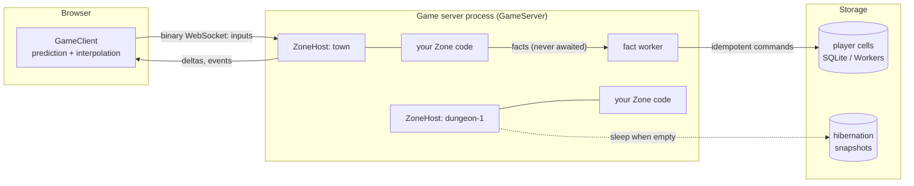

# distributed_game

A server-authoritative multiplayer game engine for the `distributed`
framework. You write the rules of a piece of your world (a **zone**) as a
plain Rust struct. The engine runs it at a fixed tick rate, takes player
input, sends each player only the changes they can see, saves important
outcomes without ever pausing the game, and spreads zones across as many
server processes as you need. A TypeScript client SDK
(`@hops-ops/distributed/game`) connects browsers to it, with prediction and
smoothing built in.

It replaces the role a room server like Colyseus plays, but in Rust and on
the same event-sourced storage the rest of `distributed` uses.

**It is:** the authoritative simulation loop, networking, replication,
persistence of outcomes, and world layout across servers.

**It is not:** a renderer, a physics engine or a content pipeline. Bring
your own physics and step it inside `on_tick`. The demos use Babylon.js in
the browser, but the client SDK has no rendering dependency.

## Contents

- [The big picture](#the-big-picture)
- [Try it](#try-it)
- [Build a zone](#build-a-zone)
- [Guides](#guides): game loop · input · what clients see · the client SDK ·
  generated clients · SvelteKit apps · client prediction (Rust → WebAssembly) · shared
  logic and data (no TypeScript twins) · saving progress · scaling out ·
  live updates · lag compensation · testing and operations · security
- [Design decisions](#design-decisions)
- [Status and limits](#status-and-limits)
- [Reference](#reference)

## The big picture



The words used throughout:

| Term | Meaning |
|---|---|
| **Zone** | One piece of the world with its own rules and state: a room, an arena, a dungeon floor, a 32 m map cell. Your code implements the `Zone` trait. Zones are the unit of simulation, ownership and scaling. |
| **ZoneHost** | Runs one zone: the fixed-timestep loop, connected clients, input queues, timers, replication. Has no networking of its own, so it is easy to test with a `ManualClock`. |
| **GameServer** | (`net` feature) A WebSocket server hosting many zones, creating them on demand, routing players, and serving `/metrics` and admin routes. |
| **Tick** | One fixed simulation step (30 Hz by default). Separate from the **patch** rate (20 Hz by default), how often clients get updates. |
| **Player / Observer** | A *player* controls something and sends inputs. An *observer* only watches: a spectator, a leaderboard page, or a client looking into the zone next door. |
| **Entity** | Something clients can see. The zone describes its entities each patch; the engine works out what changed for each client. |
| **Schema** | The kinds of entity and their fields (with quantization), usually from `#[derive(Replicated)]` views. Sent to clients on connect, so a generic client needs no generated code; a generated one adds types. |
| **Fact** | An outcome worth keeping ("Alice killed the elite"). The zone emits it (typically the cell command's own input) and moves on; a background worker commits it to storage, where the command decides the reward, and reports back later. |
| **Cell** | Durable, event-sourced state in `distributed`, for example one player's profile. Facts usually end up as commands on a cell. |
| **Ticket** | A signed, single-use admission token naming the player (principal), the zone and a role. Identity always comes from the ticket, never from game input. |

### The life of a tick

1. Inputs arrive over the socket. Each is numbered; the host drops
   duplicates and stale ones, decodes them with `Zone::decode_input`, and
   checks them with `Zone::sanitize_input`.
2. The host calls `Zone::on_tick`. Your code reads inputs with
   `ctx.take_inputs`, moves things, resolves combat, and may emit facts,
   events, timers or a handoff.
3. On patch ticks the host calls `Zone::replicate`. For each client it
   compares what you described with what that client last received, keeps
   only what the client can see (interest), fits it into the client's byte
   budget (most important first), and sends one binary **Delta** with the
   number of the last input it processed.
4. The browser applies the Delta. Other entities are drawn slightly in the
   past (interpolated) so they move smoothly. The player's own character is
   predicted from their inputs and quietly corrected when the server
   disagrees.
5. Meanwhile, emitted facts are committed by the fact worker. When one
   settles, `Zone::on_fact_settled` runs on a later tick (to show
   "saved ✓", for example). The tick never waits for storage.

## Try it

Seven runnable demos live in [`examples/game`](../examples/game/README.md),
each built to show one part of the engine:

| Demo | Run | Shows |
|---|---|---|
| Arena | `examples/game/run.sh arena` | ticks, deltas, prediction on/off, interest radius vs. global entities, simulated latency |
| Mob Pit | `run.sh mobpit` | combat whose rewards are saved without stalling; "slow storage"; `kill -9` crash recovery |
| Leaderboard | `run.sh leaderboard` | a live ranking fed from saved kills, rebuilt from history |
| Shooting Gallery | `run.sh gallery` | lag compensation on/off under latency |
| The Freeze | `run.sh freeze` | pausing every zone on two servers, updating content, resuming; safe-room reloads |
| Endless Grid | `run.sh grid` | a generated world split into zones across two servers, seamless border crossings, zones sleeping and waking |
| Boss Ripple | `run.sh ripple` | nested zones (realm › city › borough › neighbourhood) with events travelling up |

Then open `http://localhost:5173/<demo>/`. Each page explains what to try.

## Build a zone

A zone is a struct plus a few trait methods. You describe **what clients
see**, **what they send** and **what you tell them** as plain Rust structs
with derives, and the rule clients **predict** as a plain Rust function;
the engine encodes them, `distributed game-client` generates the matching
TypeScript and `distributed game-wasm` compiles the predicted step to
WebAssembly, so field order, ids, quantization and movement rules are
written down exactly once. This zone is a dot that players push left and
right:

```rust
use std::sync::Arc;
use std::time::Duration;
use distributed_game::*;

/// What clients see: one replicated kind. Field order is the wire order;
/// the KindDef and the encoding both come from this struct.
#[derive(Replicated)]
#[replicated(kind = "dot", id = 1, global)]
struct DotView {
    #[quant(min = -50.0, max = 50.0, bits = 12)] // 12-bit wire precision
    #[correct(ease = 100)]                       // client correction default
    x: f32,
}

/// What a player sends, once per tick. `from_payload` decodes it and
/// clamps `#[range]` fields, so cheating inputs never reach `on_tick`.
#[derive(Clone, Copy, GameInput)]
struct Push {
    #[range(min = -1, max = 1)]
    dx: i8,
}

/// One-off messages, with stable ids and typed payloads.
#[derive(GameEvent)]
enum RoomEvent {
    #[game_event(id = 1)]
    Hello { entity: u32 },
}

/// The predicted fields of a `dot` (named after the kind's fields).
#[derive(Clone, Copy, GameRecord)]
struct DotState {
    x: f32,
}

/// The movement rule: run by `on_tick` on the server and, compiled to
/// WebAssembly, by the browser to predict its own dot. One input is one
/// fixed 30 Hz frame.
#[predict(PushStep, kind = "dot")]
fn push_step(state: &DotState, input: &Push, _context: &(), _dt: f32) -> DotState {
    DotState { x: state.x + f32::from(input.dx) * 5.0 / 30.0 }
}

struct Room { x: f32 }

impl Zone for Room {
    type Config = ();
    type Input = Push;
    type Timer = ();
    type Message = NoMessages; // or a #[derive(GameEvent)] type (zone inbox)

    fn schema() -> EntitySchema { schema![DotView] }

    fn on_create(_ctx: &mut Ctx<'_, Self>, _: ()) -> Self { Room { x: 0.0 } }

    fn on_join(&mut self, ctx: &mut Ctx<'_, Self>, player: PlayerId) {
        ctx.send(player, &RoomEvent::Hello { entity: 1 });
    }

    // Bytes from the client → your input type (decoded and sanitized).
    fn decode_input(&self, _p: PlayerId, bytes: &[u8]) -> Option<Push> {
        Push::from_payload(bytes)
    }

    // The game rules, once per tick.
    fn on_tick(&mut self, ctx: &mut Ctx<'_, Self>) {
        let players: Vec<_> = ctx.players().map(|p| p.id).collect();
        for p in players {
            for input in ctx.take_inputs(p, ConsumePolicy::Drain) {
                self.x = push_step(&DotState { x: self.x }, &input.input, &(), ctx.dt_secs()).x;
            }
        }
    }

    // Describe the world; the engine diffs it per client.
    fn replicate(&self, out: &mut WorldView) {
        out.add(1, &DotView { x: self.x });
    }
}

/// Everything a browser needs to know about this zone, for the generator.
pub fn game_surface() -> GameSurface {
    GameSurface::for_zone::<Room>("room")
        .events::<RoomEvent>()
        .predict::<PushStep>()
}

// Drive it directly (tests, tools) with a manual clock:
let clock = ManualClock::new();
let mut host = ZoneHost::<Room>::new("room-1", HostConfig::default(), Arc::new(clock.clone()), ());
let claims = TicketClaims::new("alice", "room-1", u64::MAX, "n", Role::Player);
let joined = host.join(&claims, 0, "").unwrap();
host.push_input(joined.client, 1, 0, &Push { dx: 1 }.to_payload());
clock.advance(Duration::from_millis(100));
host.advance();
for out in host.drain_outbound() { /* Outbound::Frame bytes go to the client */ }
assert_eq!(game_surface().kinds[0].name, "dot");
```

Serve it over WebSockets (`net` feature). The zone factory decides which
zone ids this server hosts and with what config:

```rust,ignore
let server = GameServer::<Room>::new(
    ServerConfig::new(TicketKey::new(secret)),
    ZoneFactory::sync(|activation| activation.zone_id.starts_with("room-").then_some(())),
);
server.serve(tokio::net::TcpListener::bind("0.0.0.0:2567").await?, shutdown_signal).await?;
```

Generate the browser client from `game_surface` (see
[Generated clients](#generated-clients)):

```sh
distributed game-manifest --entrypoint my_game::game_surface --out room.surface.json
distributed game-client --manifest room.surface.json --out web/src/generated/room
distributed game-wasm --manifest room.surface.json --out web/src/generated/room  # push_step → wasm/room.wasm
```

Connect a browser with it. The input encoder, the correction defaults, the
event decoders and prediction (`push_step`, compiled) are generated; you
write only drawing:

```ts
import { InputPacer } from '@hops-ops/distributed/game';
import { createRoomClient, dotFields, isDot } from './generated/room/index.ts';

const room = createRoomClient({
  url: (zone) => `wss://game.example/zones/${zone}`,
  ticket: ({ zoneId, role }) => api.mintZoneTicket(zoneId, role) // your backend signs these
}); // predicts with wasm/room.wasm; `room.prediction.ready` once loaded
room.on('hello', (hello) => room.client.setControlledEntity(hello.entity)); // typed payload
await room.client.connect('room-1');
const pacer = new InputPacer({ tickRate: () => room.client.authority?.connection.welcome?.tickRate });
requestAnimationFrame(function frame(now) {
  pacer.update(now, (dtMs) => room.client.sendInput({ dx: readKeys() }, dtMs)); // one input per tick
  for (const e of room.client.render()) if (isDot(e)) draw(dotFields(e).x); // typed fields
  requestAnimationFrame(frame);
});
```

The rest of `Zone` is optional hooks: `on_auth`, `on_join`, `on_leave`,
`on_rejoin`, `on_connection_lost` (grace started), `on_reconnected`,
`on_observe`, `on_timer`, `on_fact_settled`,
`on_tier_changed`, `on_dispose`, `hibernate` / `on_restore`,
`on_handoff_join`, `on_child_event`, `is_gate`, `freeze_ready`,
`on_content_version_changed`, `record_rewind`, `state_hash`. Each is
explained in the guide that uses it. Hand-written schemas
(`EntitySchema::new().kind(KindDef::new(..).field(..))`), `EntityState`s,
byte inputs and `ctx.send_event(viewer, type_id, bytes)` still work; the
derives are a layer over them.

## Guides

### The game loop

`ZoneHost::advance()` runs as many fixed steps as real time requires,
capped at `HostConfig::max_catch_up` (5) so a stalled process skips ahead
instead of fast-forwarding. `ctx.dt_secs()` is always the fixed step.

A zone is in one of three **tiers**:

- **Hot**: someone is connected; full `tick_rate` (30 Hz).
- **Idle**: empty; ticks at `idle_tick_rate` (1 Hz) so timers and
  respawns keep going. Return `true` from `Zone::wants_background` to stay
  Idle forever (a city clock, say) or from `has_pending_work` to stay Hot.
- **Dormant**: idle for `dormant_after` (30 s); no ticks. With
  hibernation on, a Dormant zone is saved and unloaded (see
  [Scaling out](#scaling-out-many-zones-many-servers)).

`on_tier_changed` tells you about transitions. Timers
(`ctx.set_timeout(after, value)`, `ctx.set_interval(every, value)`,
`ctx.cancel_timer(id)`) fire `on_timer` on the tick they are due;
`ctx.rng()` is a seeded RNG derived from the world seed and zone id, so a
recorded session replays identically.

### Input

Clients number every input. The host keeps a bounded queue per player,
rejects duplicates and inputs older than the last processed one, and
reports the last processed number back in every Delta. The client uses
that to drop inputs the server has already applied when it reconciles.

- `#[derive(GameInput)]` generates a compact codec for an input struct
  (`i8`/`u8`/`i16`/`u16`/`i32`/`u32`/`bool`/`f32`, `#[quant]` / `#[angle]`
  floats) and its sanitize: `#[range(min, max)]` **clamps**, a
  `#[buttons(dash, attack)]` bit field clears unknown bits (and gets
  `Input::DASH`, `Input::ATTACK` constants), any non-finite `f32` rejects
  the input, and a frame of the wrong length is dropped. `decode_input`
  is then one line: `MyInput::from_payload(bytes)`. Hand-written
  `decode_input` / `sanitize_input` (rejecting or clamping anything a
  cheater could send) keep working.
- `ctx.take_inputs(player, ConsumePolicy::…)` reads them in `on_tick`.
  `InputCredits` allows one input per tick per player (with a small bank
  for network jitter), so flooding inputs cannot make anyone move faster.
- Every new connection (a fresh ticket, a reconnect token, or a reconnect
  after a content reload) starts its numbering again from 1, and so does
  the host.
- A player who reconnects with a fresh ticket while still in the zone
  gets `on_rejoin`, by default `on_leave(Rejoined)` then `on_join`, so the
  zone re-sends whatever a new client needs.
- While the world is frozen for an update, inputs are dropped and counted.

### What each client sees

Each patch, `replicate` describes every entity once: `out.add(id, &view)`
with a `#[derive(Replicated)]` view (or a hand-built `EntityState`). The
view's struct is the kind: `#[replicated(kind = "mob", id = 2, priority =
2.0, global)]`, one field per replicated field in wire order (`bool`, `u8`,
`u16`, `u32`, `i32`, `f32`, `String` as a short string, `Vec<u8>` as
bytes), `#[quant(min, max, bits)]` / `#[quant(centered = R, bits)]` (zero
exact) / `#[angle(bits)]` / `#[field_type(EXPR)]` for floats,
`#[priority(p)]`, and `#[correct(ease = ms | snap | replace)]` client
defaults. The interest position is the `x` / `y` fields (or
`#[replicated(x = .., y = ..)]`); a kind without one must be `global`.
`out.add(..)` returns a handle for `.global()`, `.local()`, `.priority(p)`.
For each client the engine then sends only the difference from what that
client already has:

- **Schema and quantization.** Fields are typed (`QuantF32`, integers,
  booleans, strings, …). Floats are quantized to the precision you choose,
  and a change too small to show up after quantization costs nothing.
- **Interest.** Each viewer has a `View` (centre and radius, set with
  `ctx.set_view`). Entities outside it are not sent and are removed from
  the client when they leave it. A spatial grid makes this cheap. Mark
  entities that everyone must always see (players in a small room, a boss,
  pillars) with `.global()`.
- **Bandwidth budget.** Each client has `byte_budget` bytes per Delta
  (4 KiB). Creates and updates compete by priority (kind × entity ×
  field × nearness). Anything deferred builds up priority, so it is always
  sent eventually.
- **Events** carry one-off messages such as "kill", "saved" or "weather
  changed" next to the Deltas. Declare them as a `#[derive(GameEvent)]`
  enum (each variant `#[game_event(id = N)]`: unit, named fields, or one
  value such as a `#[derive(GameRecord)]` struct) or struct, and send them
  with `ctx.send(viewer, &event)` / `ctx.broadcast(&event)`. Payloads use
  the same value codec as entity fields plus `i8`/`i16`/`u64`/`f64`,
  `#[long]` strings, `Vec<T>`, `Option<T>` and nested records.
  `E::decode_event(type_id, bytes)` decodes them (bots, tests). The raw
  `ctx.send_event(viewer, type_id, bytes)` remains for custom payloads.

Wire details are in [`PROTOCOL.md`](PROTOCOL.md).

### The client SDK

`GameClient` (`@hops-ops/distributed/game`) handles the connection,
reconnection and clock sync, and gives you `render()`: a list of entities
ready to draw. A [generated client](#generated-clients) wraps it with your
zone's typed fields, input encoder, events and correction defaults.

- **Interpolation.** Other entities are drawn a little in the past,
  between two received states, so movement is smooth whatever the network
  does. The delay adapts to measured latency and jitter (`AdaptiveDelay`).
- **Prediction.** The player's own entity moves the moment they press a
  key, using a `predict` function — with a generated client, the zone's
  `#[predict]` step compiled to WebAssembly (see
  [Client prediction](#client-prediction-rust--webassembly)). Each
  Delta, the client replays not-yet-acknowledged inputs on top of the
  server's state; any difference is resolved per field (`ease`, `snap` or
  `replace`). `setPredictionEnabled(false)` turns it off, to feel the raw
  latency.
- **Neighbouring zones.** `observe(zone)` opens a watch-only connection,
  so a player sees across a border before crossing it.
- **Crossing zones.** When the server hands the player to another zone
  (possibly on another server), the client follows automatically. The
  predicted character is held in place until the new zone takes over, and
  if the new zone refuses, the client goes back.
- **Content reloads.** `reloadContent` is called when the server requires
  a newer content version, and the client rejoins afterwards with the same
  player.

### Generated clients

The derives also describe the zone for the browser. A **game surface**
(`GameSurface`, versioned JSON, schema v3) lists the zone's kinds with
their fields, wire types, priorities and correction defaults, its input
layout and sanitize rules, its events and the records they mention, its
predicted step, and what else the client shares with Rust: pure functions
compiled to WebAssembly, constants and standalone record codecs. Export
one function per zone type, conventionally `game_surface`:

```rust,ignore
pub fn game_surface() -> GameSurface {
    GameSurface::for_zone::<Arena>("arena")
        .events::<ArenaEvent>()
        .predict::<ArenaStep>()
        .constant("arena_floor", &arena_floor())
}
```

`distributed game-manifest` builds and runs it (through the same harness
as `distributed describe`), and `distributed game-client --manifest
<json> --out <dir> [--check]` writes framework-neutral TypeScript that
imports only `@hops-ops/distributed/game`:

| File | Contents |
|---|---|
| `schema.ts` | `KIND` ids, `PlayerFields` interfaces with `isPlayer(e)` / `playerFields(e)` over rendered or replica entities (camelCase properties), `FIELD_TYPES`, `CORRECTIONS` |
| `input.ts` | the input interface, `BITS` / `BUTTON`, `encodeInput`, `decodeInput`, `sanitizeInput` (what the server will simulate) |
| `events.ts` | record and event interfaces, `EVENT` ids, `EVENTS` codecs, `decodeEvent`, `onEvent` |
| `client.ts` | `create<Name>Client(options)`: a `GameClient` with the encoder and correction defaults wired in (and, with a predicted step, prediction by the compiled step), a typed `on(name, handler)` and `send(input)` |
| `predict.ts` | with a `#[predict]` step: `PREDICT`, the state/context layouts, `PREDICT_WASM_URL` (`./wasm/<name>.wasm`) and `create<Name>Prediction` |
| `pures.ts` | with `#[game_pure]` functions: `PURES`, `PURES_WASM_URL` (the same module) and `create<Name>Pures()`, one typed wrapper per function |
| `constants.ts` | with `.constant(..)`s: each value as a typed literal (`ARENA_FLOOR: ArenaFloor`) |
| `index.ts`, `surface.json` | re-exports; the surface it came from |

`events.ts` also gets `encode<Record>` / `decode<Record>` for every
`.record::<T>()` (see [Shared logic and data](#shared-logic-and-data-no-typescript-twins)).

The output is deterministic, so check it in and run `--check` in CI: a
changed Rust definition then fails the build until the client is
regenerated. The binary protocol is unchanged; the generated code only
removes the hand-written glue around it. The compiled module
(`distributed game-wasm`, `wasm/<name>.wasm`: the predicted step and the
pure functions) is a build output: ignore `wasm/` in version control and
build it before bundling.

### SvelteKit apps

`@hops-ops/distributed` integrates zones with SvelteKit where it removes
boilerplate — admission, code generation and the HUD around the game — and
leaves the canvas and render loop to you (game state is never
server-rendered). Full API: [js README](../js/README.md#game-zones-in-sveltekit);
runnable: [`examples/game/sveltekit`](../examples/game/sveltekit)
(`examples/game/run.sh sveltekit`).

1. **Tickets from the session.** `createGameTicketHandler` (server-only,
   `@hops-ops/distributed/sveltekit/game/server`) is a `POST` route that
   signs this crate's ticket format (§8, HS256 with the zone servers'
   `TicketKey` secret) for the app's **verified session** principal and the
   zone **your server code** chooses. The browser may only hint `{ zone,
   role }`; any other body field is refused, so identity, ownership and
   rewards never come from the request. Same-origin, a per-principal rate
   limit and `cache-control: no-store` are built in; the zone server still
   enforces signature, zone, expiry and single use. Extension claims (match
   id, team…) come only from the server-side `claims(context)` callback and
   are signed under `ext`. `js/tests` reproduce
   `tests/fixtures/sveltekit_tickets.json` byte for byte and `net_e2e`
   admits those tickets on a real `GameServer` (and refuses tampered,
   expired, wrong-zone and replayed ones).
2. **Clients generated by Vite.** `distributedSvelteKit({ games: [...] })`
   runs `game-manifest` → `game-client` → `game-wasm` on dev start, on Rust
   changes and on build; `checkDistributedGames` is the CI check.
3. **Runes state.** `useGame(() => create<Name>Client({ url, ticket:
   gameTicketSource() }), { zone, events: EVENTS })` gives reactive
   `status`, `zone`, `rttMs`, `predictionReady`, `error` and typed
   `latest(event)` / `events(event)`; it connects on mount and closes on
   destroy or navigation.
4. **Settled progress through the business side.** Game state stays in the
   zone; what a player keeps belongs to a Distributed service. Mark the cell
   command's event as a domain event (`#[event(.., domain)]` +
   `repo.publish_events()`), drain the cell outbox onto a bus
   (`AggregateCell::drain_outbox_with(BusPublisher::new(bus), ..)`), project
   it with a modeled projector into a SQL read model and read that with
   generated `@load @live` GraphQL (`clients` in the same Vite plugin,
   session-bound variables via `sessionClaim`). The example does this with
   `mobpit_service` and a SQLite bus.

```ts
// src/routes/api/game/ticket/+server.ts
export const POST = createGameTicketHandler({
  secret: () => env.GAME_TICKET_SECRET,
  getSession: (event) => event.locals.auth(),
  zone: ({ principal }) => zoneFor(principal)
});
```

### Client prediction (Rust → WebAssembly)

Prediction is an optimistic update at tick rate: the client applies each
input to its own entity at once and, on every Delta, replays the inputs the
server has not acknowledged yet on top of the authoritative state. That is
only invisible if the client's step is *exactly* the server's. So the step
is declared **once**, in Rust, and the browser runs it compiled to
WebAssembly — there is no TypeScript twin to keep in sync.

```rust,ignore
/// Predicted fields of the `player` kind (same names, plain scalar types:
/// `f32` for quantized floats, u8/u16/u32/i32/bool otherwise).
#[derive(Clone, Copy, GameRecord)]
pub struct MoveState { pub x: f32, pub y: f32, pub vx: f32, pub vy: f32, pub dash: u8, pub cd: u8 }

/// Read-only data the client supplies (optional; `&()` for none).
#[derive(Clone, Copy, GameRecord)]
pub struct GridContext { pub seed: u32, pub cx: i32, pub cy: i32 }

#[predict(GridStep, kind = "walker")]
pub fn grid_step(state: &WalkerState, input: &MoveInput, context: &GridContext, _dt: f32) -> WalkerState {
    let props = cell_props(context.seed, (context.cx, context.cy));
    let (x, y) = step(state.x, state.y, *input, &props);
    WalkerState { x, y }
}
```

- **Declare.** `#[predict(StepType, kind = "…")]` on a
  `fn(&State, &Input, &Context, dt: f32) -> State` keeps the function and
  adds `StepType: PredictStep`. `Input` is the zone's `GameInput`; the
  WASM side decodes it with `from_payload`, so it steps exactly what the
  server simulates (ranges clamped, unknown buttons cleared). Call the
  function from `on_tick` (or the code it wraps) so there is one rule.
- **Record.** `GameSurface::…​.predict::<StepType>()` checks that the kind
  is replicated, that the step takes the zone's input, and that every state
  field is a field of the kind with a matching type (it panics at export
  time otherwise), then records the step, its state/context records and
  the declaring Cargo package in the surface.
- **Build.** `distributed game-wasm --manifest <surface.json>
  --manifest-path <Cargo.toml> --out <generated dir>` compiles that package
  for `wasm32-unknown-unknown` (`cargo rustc --release --crate-type
  cdylib`) and writes `wasm/<name>.wasm`, stamped with the sources'
  fingerprint. Put the step and everything it reads in a crate without
  server-only dependencies (the demos use `game_sim`); `distributed_game`
  itself compiles to `wasm32` with default features.
- **Run.** The generated `create<Name>Client` loads the module and predicts
  with it; `client.prediction.setContext(…)` provides the context.
  `prediction: false` turns prediction off; a `predict` in `prediction`
  replaces it.

**Binary ABI (v1).** The module imports nothing and exports `memory`,
`dg_predict_abi() -> 1`, `dg_predict_buffer()` (a 64 KiB scratch area) and
`dg_predict_<fn>(state_len, input_len, context_len, dt) -> i32`. The client
writes `state ‖ input ‖ context` into the scratch area — state and context
with the payload codec (binary32 floats, never rounded through JSON or
`f64`), the input as its wire payload — calls the step, and reads the next
state from the start of the buffer (a negative result is an error code).
`prediction::step_bytes::<Step>` runs the same path natively.

**Determinism.** Native and WASM results are bit-identical when the step
uses only operations that are correctly rounded on both targets: `+ - * /`,
`sqrt`, `abs`, `min`/`max`, `floor`/`ceil`/`trunc`/`round`, comparisons and
integer arithmetic (Rust never fuses `a * b + c` into an FMA on its own).
Transcendentals are **not** portable: `sin`, `cos`, `atan2`, `exp`, `ln`,
`powf` use the platform libm natively and another implementation on
`wasm32`. If a step needs them, use one deterministic implementation on
both sides (the `libm` crate, or a polynomial in plain arithmetic). Never
produce NaN (payloads may differ). Prefer fixed command frames (one input
= one tick, `dt` ignored) and snap replicated floats to their wire
quantization after each step, so the server holds exactly what clients
decode. The demos prove all of this per step function: `game-demos
predict-trace` prints native traces over recorded input streams
(scripted, random, every sanitize edge) and
`examples/game/client/tests/prediction-wasm.test.mjs` requires every state
from the compiled module to be byte-identical (16 788 frames across the
four steps — 20 744 comparisons over the five surfaces' modules —
including the grid's prop collisions).

**Cost.** Measured on Apple silicon: ~0.2 µs per raw ABI call, ~0.8 µs per
`predict` (fields → bytes → step → fields) in Node 24 and ~1.2 µs in Chrome
156; a reconciliation that replays 10 pending inputs takes ~8–12 µs.
At 30 Hz input and 20 Hz Deltas that is ≈ 0.2 ms of prediction per
second — far below one 33 ms frame. The module is ~90 KB (the demos' four
steps plus the grid's world generation).

**Security.** Prediction is cosmetic. The server never runs client code
and never trusts a predicted value: it simulates the inputs itself, and
every Delta replaces the prediction with the authoritative state.

### Shared logic and data (no TypeScript twins)

Prediction is not the only client code that must agree with the server.
Procedural content, drawing constants and served data have the same
problem: a TypeScript copy drifts. The surface gives each kind of shared
thing one home in Rust and one generated way into the client:

| What | Rust | Surface | Client |
|---|---|---|---|
| **Logic** (pure functions: world generation, previews) | `#[game_pure(FnType)] fn f(arg: &A) -> R` (or `fn f() -> R`) | `.pure::<FnType>()` | `create<Name>Pures().f(arg)`: the same code, compiled into the surface's WebAssembly module |
| **Static data** (sizes, layouts, names) | any `Wire` value (`#[derive(GameRecord)]` struct, list, …) | `.constant("name", &value)` | `NAME` in `constants.ts`, a typed literal |
| **Served data** (fetched at run time, e.g. a content pack) | a `#[derive(GameRecord)]` struct | `.record::<T>()` | `decodeT(bytes)` / `encodeT(value)` over the payload codec |

Choose by what the thing *is*: computation the client repeats with
arguments it only knows at run time belongs in a pure function (the
Endless Grid generates terrain and props for any cell); data fixed at
build time is a constant (no module to wait for, readable in diffs);
data that changes after the client was built is served and decoded (The
Freeze's content packs, which a client must be able to receive without a
rebuild).

```rust,ignore
/// What the page draws for one cell (terrain lattice + props).
#[game_pure(GridCellFn)]
pub fn grid_cell(cell: &GridContext) -> GridCellContent {
    /* the server's own generation */
}

pub fn game_surface() -> GameSurface {
    GameSurface::for_zone::<GridZone>("grid")
        .predict::<GridStep>()
        .pure::<GridCellFn>()
        .constant("grid_world", &grid_world())
}
```

```ts
const pures = createGridPures(); // same module (and instance) as the predicted step
await pures.ready;
const content = pures.gridCell({ seed, cx: 3, cy: -2 }); // GridCellContent, exact binary32 floats
```

- **Pure functions** share the predicted step's module, package and ABI
  v1: each is an export `dg_pure_<fn>(arg_len) -> i32`; the argument's
  codec encoding goes into the scratch buffer, the result's comes back
  (≤ 64 KiB; negative results are errors, `-6` = argument does not
  decode). Every function and the step of one surface must be declared in
  one Cargo package; `distributed game-wasm` builds the module when a
  surface has either and checks every export. The wrappers are
  synchronous and throw until `ready` resolves. `pure::call_bytes::<F>`
  runs the export's path natively, so native ↔ WASM tests compare bytes.
  The [determinism rules](#client-prediction-rust--webassembly) apply.
- **Constants** are stored in the surface as the client decodes them
  (`codec::to_json_value`: encoded, then decoded against the wire type —
  floats are exact binary32 values, quantized fields quantized), so the
  generated literal equals what `decodeValue` would return for the Rust
  encoding.
- **Record codecs** are the event payload codec for one record; serve the
  bytes (`codec::to_bytes`) from any transport.

The demos have no TypeScript twins left for these: the Endless Grid's
terrain, biomes and props (`grid_cell`, `grid_sample`), the Arena floor,
The Freeze's world layout and content packs, Mob Pit's tier radii and
Boss Ripple's zone hierarchy all come from Rust. `game-demos
predict-trace` also prints native traces of every pure function, and
`prediction-wasm.test.mjs` requires the module's results to be
byte-identical (1 440 `grid_sample` points and 64 `grid_cell` cells,
coordinate limits included). Generating one grid cell (17 × 17 heights,
moisture and biomes plus props) costs ~6 µs in the module and ~13 µs
including decoding the result into JS objects in Node 24 (native Rust
~5.6 µs; the removed TypeScript twin took ~77 µs); a point sample ~0.5 µs.

### Saving progress without pausing the game

The rule: **the tick never waits for storage.** A slow disk or a busy
database must not freeze the world. Zones emit **facts** and continue.
A fact is the cell command's own input type, bound to the command name
with `#[derive(FactCommand)]` (pointing at the same constant the cell
mounts the command under):

```rust,ignore
#[derive(Serialize, CommandInput, FactCommand)]
#[fact(command = RECORD_KILL)]          // typed_command::<RecordKillInput, _>(RECORD_KILL)
pub struct RecordKillInput { pub mob: String, pub tier: u8 }

// in on_tick: key "crawler.record_kill:{zone}:{boot_epoch}:m{mob}:{generation}"
ctx.emit_keyed(killer, RecordKillInput { mob, tier }, &[&format_args!("m{id}"), &generation])?;
```

- The host attaches the killer's **verified identity** from their ticket.
  The zone cannot claim to be someone else, and the payload names no
  reward amount; the command handler decides the XP from what it trusts.
  The derive refuses identity-, reward- and economy-looking fields
  (`principal`, `user_id`, `owner`, `xp`, `reward`, `amount`, `coins`,
  `gold`, `currency`, `price`, `cost`, `balance`, `grant`, `payout`,
  `credit`, `debit`; `_`/`-`/case ignored, serde renames and aliases
  included) at compile time, one error per field.
- Keys are restart-safe automatically: `ctx.emit(player, input)` uses the
  input's `#[fact(key(field, ..))]` parts, or the tick and emission order;
  `ctx.emit_keyed` takes explicit parts; `ctx.emit_zone` emits a zone
  fact with no principal; `ctx.fact(&input)` builds the `Fact` for a retry
  backlog. `Fact::new(key, command, json)` still works.
- A background worker commits facts with retries.
  `cell::CellFactSink` turns each one into a command on that player's
  cell, with a command id derived from the fact key. A retry or a
  duplicate is therefore a harmless replay, never a double reward.
- `on_fact_settled` reports the outcome on a later tick.
- Keys must be unique across restarts; `ctx.fact_key` includes the
  activation's boot epoch for you (see [Durable facts](#durable-facts)).
- If the process crashes, each in-flight fact is either fully saved or
  not saved at all. Mob Pit shows this with `kill -9`.
- **Player lifecycle facts.** With `HostConfig::lifecycle_facts = true`
  the host itself emits `lifecycle::PlayerJoined` (ticket, rejoin or
  handoff), `ConnectionLost` (grace started; dropped or told to reload),
  `PlayerReconnected`, `PlayerDisconnected` (grace expired) and
  `PlayerLeft { reason }` as facts bound to the verified principal, so
  presence, match admission and abandon need no hand-written facts. Keys
  are `{command}:{zone}:{boot_epoch}:p{slot}:{n}` (stable across retries,
  new after a restart); they share the principal's commit lane (order kept
  with `max_concurrent_commits > 1`) and wait in a host backlog rather
  than being dropped when the queue is full. `lifecycle::Lifecycle::of(&fact)`
  decodes them in a sink. Mob Pit projects them into a presence read model
  (`/dev/mobpit/presence`), ordered by stamp.
- Every fact carries a `FactStamp`: zone, activation (boot epoch), tick,
  host wall time `emitted_at_ms` (`Clock::unix_ms`; `ManualClock` in
  tests), content version and config version (`HostConfig::config_version`,
  `ctx.set_config_version`). The cell sink passes it to handlers as
  trusted `x-game-*` session variables (`cell::session_stamp`), and
  `stamp_metadata` / `FactStamp::from_metadata` copy it onto events.
- **Commit order is not emission order.** Order facts with
  `FactStamp::emission_order` (same zone: activation, then tick; across
  zones: wall time). After a handoff the target's stamps start after the
  source's departure time, which the transfer ticket carries, so "joined
  B" sorts after "left A" even when it commits first or the two hosts'
  clocks disagree.

### Scaling out: many zones, many servers

- **Placement.** A `ZoneDirectory` (`HashRing`) maps each zone id to a
  host. A client that connects to the wrong host is told where to go
  (`Redirect`) and follows automatically.
- **One owner at a time.** Each activation of a zone holds a fenced claim
  (`ZoneOwnership`, with leases in production). Two servers never run the
  same zone, and a server that loses its claim stops without saving.
- **On demand and asleep.** Zones start on first use. With
  `hibernate_after`, an empty zone is saved (`Zone::hibernate`) and
  unloaded, and restored (`on_restore`) the next time someone arrives.
- **Handoff.** `ctx.handoff(player, "next-zone", carried_bytes)` moves a
  player to another zone, on any server, with a signed transfer ticket.
  The target receives `on_handoff_join` with the carried state. When the
  player's durable records must move too, emit a fact and let a
  `distributed::saga` do it off the tick.
- **Hierarchy.** Zone ids like `realm.city.borough` form a tree
  (`DottedTopology`). `ctx.emit_upward(…)` sends an event to the parent
  zones, wherever they run, and each level can tick at its own rate
  (`GameServer::with_host_config`).

### Live content updates

`WorldCoordinator::rollout` updates content across every server:

1. **Freeze**: every zone pauses, shows the update notice, and drops
   inputs. A zone can delay with `freeze_ready` (for example, mid-ritual).
2. **Apply**: your function switches the content version (it may be
   async, a download for example).
3. **Resume**: everyone continues on the new version. Facts are stamped
   with the version they happened under.

If any zone does not acknowledge in time, the rollout is **aborted** and
everyone resumes on the old version. In `Hard` mode every client reloads
at once. In `Rolling` mode with `StalePolicy::SafeRoom`, clients that
cannot patch live keep playing until they walk into a gate zone
(`is_gate`), where they reload.

### Lag compensation

For hit-scan weapons, the server judges a shot against where targets were
**on the shooter's screen** when they fired, not where they are when the
shot arrives. `record_rewind` stores hit volumes each tick, and
`ctx.rewind().hit_test_shot(timing, ray, filter)` tests against that
moment, capped at `max_rewind` (500 ms by default) so lag cannot buy
unlimited rewind.

### Testing and operations

- **Deterministic tests**: drive `ZoneHost` with `ManualClock`; the RNG
  is seeded.
- **Record and replay**: `Recorder` captures a session; `replay` re-runs
  it and pinpoints the first tick that differs.
- **Metrics**: `GET /metrics` (Prometheus): tick time, players, entities,
  inputs by outcome, bytes per Delta, facts pending and settled.
- **Load bots**: `game-bots` connects N WebSocket clients and reports
  round-trip time and bandwidth.
- **Network simulation**: `NetSim` adds latency, jitter and loss in
  development, and can be changed at runtime.

### Security

- Players are admitted only with a signed, single-use, expiring ticket.
  Your web backend mints it (in SvelteKit, `createGameTicketHandler` binds
  it to the verified session — see [SvelteKit apps](#sveltekit-apps)); plug
  in your own verifier with `with_ticket_verifier`.
- The ticket's principal is the only identity the zone sees, and the only
  one attached to facts. Inputs are game data, never identity, owner or
  reward amounts.
- Admin routes (transfers, tier events, rollout) need a separate shared
  secret.

## Design decisions

- **Server-authoritative, not lockstep or peer-to-peer.** The server owns
  the truth and clients predict. That tolerates cheaters and mixed
  latencies, and needs only one simulation per zone.
- **Zones, not one global world loop.** A zone is the unit that ticks,
  sleeps, moves between servers and is owned by exactly one process.
  Actors live inside their zone. Only things that outlive a zone (a
  player's profile, a match) get their own durable cell.
- **Facts, not per-tick persistence.** Movement and combat ticks are never
  stored, only meaningful outcomes. The tick enqueues and moves on, so
  storage speed never shows up as lag.
- **Idempotency through keys, not a zone-side outbox.** A fact key plus
  the cell's command ledger make retries safe. An outbox on the zone
  would add a second write per outcome for little gain, since the zone
  state lost in a crash is lost either way.
- **Static world from a seed.** Terrain and props are a pure function of
  seed and content version, generated identically on server and client.
  Only things that change are replicated.
- **Prediction compiled from the server's Rust, over a binary ABI.** A
  TypeScript twin of the movement code drifts the first time someone
  changes one side; running the same Rust as WebAssembly cannot. JSON
  bridges (as browser WASM pures use) round-trip `f32` through `f64` and
  allocate per call; a fixed scratch buffer with codec-encoded state keeps
  every float bit and costs about a microsecond per step.
- **Binary protocol with the schema sent on connect.** Small,
  diff-friendly frames, and any client can decode them without generated
  code.
- **Reliable, ordered WebSockets.** Deltas are computed against what each
  client last received, which only works because nothing is lost or
  reordered. Loss shows up as delay, which the adaptive interpolation
  absorbs.

## Status and limits

- Pre-release, on the unreleased v5 line.
- Covered by unit, integration and golden-wire tests, plus the demos'
  smoke tests (bots and headless browsers).
- **Not yet verified here:** `FencedLeaseOwnership` on Postgres (Docker
  was unavailable) and the Redis leaderboard against a real Redis (only a
  fake).
- No production deployment or load testing beyond local bots.
- WebSocket only (no UDP or WebTransport). No built-in physics. Exact
  input replay needs the predicted step to be what `on_tick` runs: declare
  it once with `#[predict]` and call it from the zone. Steps must stay
  within portable float operations (see
  [Client prediction](#client-prediction-rust--webassembly)).

---

# Reference

## Authoring derives

Re-exported from `distributed_game_macros`; each has spanned compile
errors for unsupported types and attributes.

| Derive | On | Container attribute | Field attributes | Implements |
|---|---|---|---|---|
| `Replicated` | struct | `#[replicated(kind = "name", id = N, priority = P, global, x = f, y = f)]` | `quant`, `angle`, `field_type`, `priority`, `correct` | `Replicated` (`kind_def`, `field_values`, `position`) |
| `GameInput` | struct | – | `range`, `buttons`, `quant`, `angle`, `field_type` | `GameInput` (`from_payload`, `to_payload`, `sanitize`) + button consts |
| `GameEvent` | enum / struct | `#[game_event(id = N, name = "..")]` per variant / on the struct | `quant`, `angle`, `field_type`, `long` | `GameEvent` (`decode_event`, `to_payload`) + id consts |
| `GameRecord` | struct | – | `quant`, `angle`, `field_type`, `long` | `Wire` (nested payload record) |
| `FactCommand` | struct (`Serialize`) | `#[fact(command = CONST_OR_LITERAL, key(field, ..))]` | – | `FactCommand` (`COMMAND`, `dedupe_parts`) |
| `#[predict]` (attribute) | `fn(&State, &Input, &Context, f32) -> State` | `#[predict(StepType, kind = "name")]` | – | `struct StepType: PredictStep` + the `wasm32` export `dg_predict_<fn>` |
| `#[game_pure]` (attribute) | `fn(&A) -> R` or `fn() -> R` (`Wire` types) | `#[game_pure(FnType)]` | – | `struct FnType: GamePure` + the `wasm32` export `dg_pure_<fn>` |

`schema![A, B]` builds an `EntitySchema`; `GameSurface::for_zone::<Z>(name)`
(kinds from `Z::schema()`, input from `Z::Input`) `.events::<E>()`
`.predict::<S>()` `.pure::<F>()` `.constant(name, &v)` `.record::<T>()`
builds the surface; `codec` holds the shared value codec (`Wire`,
`WireType`, `to_json_value`); `prediction` the predicted-step trait, its
ABI (`run_abi`, `step_bytes`) and the float rules; `pure` the pure-function
trait and its ABI (`run_abi`, `call_bytes`).

## Features

| Feature | Adds | Deps |
|---|---|---|
| *(default)* | Zone/host runtime, facts queue, protocol, schema, replication, authoring derives, game surface, predicted steps (compiles to `wasm32-unknown-unknown`, where `#[predict]` exports its steps) | `serde`, `serde_json`, `distributed_game_macros` |
| `runtime` | `spawn_fact_worker` on Tokio | `tokio` (rt, time, sync) |
| `cell` | `cell::CellFactSink` → in-process `AggregateCell::dispatch_idempotent` (native); `cell::fact_session_from_headers` / `session_stamp` for cells (also wasm32); `stamp_event_record` | `distributed`, `sha2` |
| `celld` | `celld::CelldFactSink`: facts → celld cells over the internal HTTP path, routed by command; `celld::CellZoneOwnership`: zone leases in celld `ZoneLease` cells | `cell` + `reqwest`, `uuid` |
| `metrics` | `metrics::GameMetrics` per-zone Prometheus text | – |
| `net` | `net::GameServer` (axum WebSocket), HMAC tickets, `GET /metrics` (implies `metrics`), handoff, admin peer routes, `WorldCoordinator` | `axum`, `hmac`, `sha2`, `base64`, `tokio` |
| `bots` | `bots` load-test client library + `game-bots` binary | `net` + `tokio-tungstenite` |
| `lease` | `world::FencedLeaseOwnership` over `distributed::lease` | `distributed` |
| `sqlite` | `world::SqliteZoneStateStore` (hibernation snapshots) | `rusqlite` (bundled) |

## Durable facts

Zones never await storage. Emit a fact during a tick — typed (the cell
command's input with `#[derive(FactCommand)]`, key derived for you) or by
hand:

```rust,ignore
ctx.emit_keyed(player, SlayInput { enemy: enemy_id }, &[&enemy_id, &enemy_generation])?;
// "hero.slay:{zone}:{boot_epoch}:{enemy}:{generation}"; or by hand:
let key = ctx.fact_key("slay", &[&enemy_id, &enemy_generation]); // "slay:{zone}:{boot_epoch}:…"
ctx.emit_fact_for(player, Fact::new(key, "hero.slay", json!({"enemy": enemy_id})))?;
```

Settlements: `settlement.is::<SlayInput>()`, and
`receipt.payload_as::<SlayReceipt>()` for the command's typed output.

> **Warning — restart-safe keys.** Ticks, entity ids and generations all
> restart from zero when a process restarts (or a zone is re-activated from
> a snapshot). A key derived only from them — `format!("kill:{zone}:{tick}")`
> — **collides with an earlier run's key**, and an idempotent sink then
> treats the new outcome as a replay of the old one: the XP is silently
> never credited. Always include `ctx.boot_epoch()` (unique per activation,
> increasing across restarts; the `net` server uses the activation's fencing
> token, a bare `ZoneHost` Unix microseconds, or `HostConfig::boot_epoch`)
> — `ctx.fact_key(prefix, parts)` / `fact_key(prefix, zone, epoch, parts)`
> do it for you.

The host binds the principal from the player's **verified ticket** and
stamps zone, activation, tick, wall time, content and config version. A `FactSink` commits facts on a worker
with bounded retries/backoff; `Zone::on_fact_settled` receives the outcome
on a later tick. `cell::CellFactSink` dispatches into an `AggregateCell`
with a deterministic command id per fact key, so retries replay instead of
double-crediting. A custom sink needs only crate-root imports:
`impl FactSink for MySink { fn commit<'a>(&'a self, fact: &'a Fact) -> BoxFuture<'a, Result<FactReceipt, FactError>> { Box::pin(async move { … }) } }`
(`BoxFuture` is also re-exported from `world` and `net` for
`ZoneOwnership` / `BarrierParticipant` impls).

**Facts to celld cells.** Durable aggregates live in celld cells; a zone
server sends its facts there with one `celld::CelldFactSink` (feature
`celld`), routing each fact by its command to a cell kind and shard:

```rust,ignore
let sink = CelldFactSink::new(celld_url, InternalHttpSecret::new(secret)?, "zone-server", "zone:pit-1")?
    .route(CelldFactRoute::by_principal::<RecordKillInput>("crawler"))      // Crawler:{principal}
    .route(CelldFactRoute::by_input_field::<MatchResultInput>("match", "match_id"))
    .lifecycle_route("presence");                                            // zone.* → Presence:{account}
let (queue, feed) = fact_channel(capacity, RetryPolicy::until_settled(base, max));
spawn_fact_worker(feed.with_max_concurrent_commits(n), sink);
```

Each fact is `POST {CELLD_URL}/{kind}/{shard}/{command}` with
`{commandId, input}`; the command id is `cell::command_id_for(service,
key)`, so a retry after a timeout replays the cell's ledger receipt
(`replayed`) instead of committing twice. The principal travels as
`x-user-id` and the command-ledger principal partition, the stamp as
`x-game-*` headers, and every request carries
`DISTRIBUTED_INTERNAL_SECRET`; the cell rebuilds the trusted session with
`cell::fact_session_from_headers` after checking the secret. Player
lifecycle facts route to presence, never to gameplay cells. celld slow,
unreachable or answering 5xx/`COMMAND_IN_PROGRESS` is `Retryable`: with
`RetryPolicy::until_settled` the fact stays in the queue (no local durable
fallback), the zone keeps ticking, a full queue answers `Backpressure`,
and after celld returns the backlog drains in per-principal order. An
unrouted command, a rejected command or a bad shard is `Permanent`.
`tests/celld_facts` proves this on `celld dev` against
`tests/celld/fact-worker`, including a crash and restart of celld.

**Throughput.** One worker per zone commits facts in emission order, one at
a time (a slow commit delays every later fact). Set
`ServerConfig::max_concurrent_commits` (or
`FactFeed::with_max_concurrent_commits`) above 1 to overlap commits in
**per-principal lanes**: a principal's facts (and, separately, zone facts
without a principal) stay sequential in emission order; different
principals commit concurrently; settlements arrive in completion order.

## Netcode and operations

- **Admission tickets** (`net`): by default join tickets are HS256 JWTs
  signed with `ServerConfig::ticket_key` (PROTOCOL.md §8). To admit tickets
  your web backend already mints, plug in a verifier —
  `ServerConfig::new(key).with_ticket_verifier(|token: &str, zone: &str, now: u64| { … })`
  (or implement `net::TicketVerifier`) — that checks your issuer, audience
  and lifetime (`net::decode_hs256` verifies an HS256 signature and
  returns the claims) and returns `TicketClaims` with `zone` = the route
  zone and `nonce` = your replay key (e.g. `jti`). The server still
  enforces route zone, expiry and single use; `TicketClaims::name` becomes
  `PlayerInfo::name` / `ObserverInfo::name` and travels with handoffs.
  Transfer tickets always use `ticket_key`.
- **Extension claims**: game-declared claims the issuer vouches for (match
  id, team, party) travel in the ticket's `ext` object. Declare them once —
  `#[derive(Serialize, Deserialize, TicketExtension)] struct MatchClaims {
  match_id: String, team: u8 }` — and admit them with
  `ServerConfig::with_ticket_extensions::<MatchClaims>()`. The derive
  refuses identity-, reward- and economy-looking names (the `FactCommand`
  deny list, shared with the JS handler through
  `tests/fixtures/trusted_field_denylist.json`); the server refuses tickets
  whose `ext` has undeclared names or wrong types, and any `ext` when no
  schema is declared (join tickets from any verifier and transfer tickets
  alike). Zones read them typed in `on_auth`
  (`req.claims.extensions.typed::<MatchClaims>()`) and afterwards from
  `PlayerInfo::extensions`; a rejoin replaces them with the fresh ticket's
  and handoffs carry them to the next zone.
- **Input pacing**: `InputCredits::new(max)` gives each player one input
  credit per tick (banking up to `max` for jitter bursts);
  `credits.take(ctx, player)` consumes queued inputs while credits last, so
  a client can never simulate faster than real time by flooding inputs.
  Pair it with the JS SDK's `InputPacer` (one input per server tick from a
  render loop).
- **Observers**: `Ctx::observer(id)` / `observers()` / `observers_of(principal)`
  expose each observer's verified principal and name (also during
  `on_unobserve`); `ctx.send_event(observer_id, …)` addresses one observer.

- **Lag compensation** (`rewind`): implement `Zone::record_rewind` to push
  hit volumes (sphere / vertical capsule + numeric fields) each tick; the
  host keeps a ring buffer sized by `HostConfig::rewind.max_rewind`
  (default 500 ms). In a hook,
  `ctx.rewind().hit_test_shot(ShotTiming { client_tick, interp_delay }, &HitQuery::ray(o, d, range), |id| id != me)`
  evaluates at the shooter's view time, clamped to `max_rewind` and the
  stored history. The interpolation delay travels in the game's input
  payload (no wire change).
- **Record/replay** (`replay`): drive a host through `Recorder` (same
  methods as `ZoneHost`), save the compact `Recording` (`DGR3`), and
  `replay::<Z>(&recording, config)` re-runs it on a `ManualClock`,
  checking a per-tick state hash (`Zone::state_hash`, or the replicated
  `WorldView`). A mismatch returns a `Divergence` naming the tick and the
  stimuli applied since the last matching tick. Fact settlements are
  replayed on the tick they were delivered. World entry points (`join_transfer`,
  `reconnect_with_version`, `set_content_version`, `request_freeze` /
  `cancel_freeze`, `reload_stale_players`, `deliver_child_event`,
  `restore`) are recorded too; zone-issued handoffs replay against a stub
  issuer that always signs.
- **Metrics** (`metrics`, served by `GameServer` at `GET /metrics`):
  tick duration histogram, ticks/dropped ticks, tier, players, observers,
  entities, inputs by outcome (incl. `rate_limited` and `frozen` barrier drops),
  Delta bytes per frame, facts pending/settled.
  Only the first `ServerConfig::metrics_zone_labels` (default 64) live
  zones get a `zone` label; the rest aggregate into `zone="_other"`.
  `AdvanceReport` carries the raw numbers for custom drivers.
- **Bots** (`bots`): `run_bots(BotConfig, |i| behaviour)` connects N
  WebSocket clients with signed tickets, sends inputs (random walk,
  circle, or your own `Behaviour`), measures RTT and Delta bytes/s:
  `cargo run -p distributed_game --features bots --bin game-bots -- --url ws://127.0.0.1:2567 --zone room-1 --bots 50`.
- **Network simulation** (`NetSim`, dev only): one-way latency + uniform
  jitter + loss, per direction. WebSockets are reliable and ordered, so
  loss is simulated as a TCP retransmission delay (`retransmit`, default
  200 ms, up to 3×) with head-of-line blocking, never as a dropped or
  reordered message. `config.net_sim = NetSim::from_env()` reads
  `DG_NET_LATENCY_MS`, `DG_NET_JITTER_MS`, `DG_NET_LOSS`,
  `DG_NET_RETRANSMIT_MS`. `GameServer::set_net_sim(Some(sim) | None)`
  changes it at runtime for every connection (order is preserved).

## World structure

`world` (no feature needed for the traits and in-memory impls):

| Piece | Purpose |
|---|---|
| `ZoneDirectory` (`StaticDirectory`, `HashRing`) | zone → owning `HostAddr`. `HashRing` uses virtual nodes; adding/removing one of N hosts moves ~1/N of the zones. A Hello for a zone owned elsewhere gets `Redirect(zone, url)`; `url` is the owner's `HostAddr::ws_url` (advertise a proxied public URL with `HostAddr::with_ws_url`) or `ServerConfig::with_redirect_url(\|host, zone\| …)`. |
| `ZoneOwnership` (`LocalOwnership`, `FencedLeaseOwnership<S: LeaseStore>`, `celld::CellZoneOwnership`) | every activation acquires a fenced claim (`host#activation`) and renews it; a failed renewal disposes the zone **without** saving. Two hosts never run the same zone. `CellZoneOwnership` keeps each claim in a celld `ZoneLease:{zone}` cell (`world::zone_lease`, mount with `mount_zone_lease`): acquire and release publish `zone.activated` / `zone.released`, renewals are internal (no outward events), and the cell's alarm publishes `zone.lease_expired { zone_id, holder, token }` when a holder stops renewing, so services see a crashed zone server. `world::ownership_conformance` is the behaviour every implementation passes. |
| `ZoneStateStore` (`MemoryZoneStateStore`, `SqliteZoneStateStore`) | hibernation snapshots, written under the claim's fencing token (stale writers get `StateError::Stale`, counted in `distributed_game_hibernation_saves_total{outcome="stale"}` and logged to stderr, never silently dropped). `LocalOwnership` seeds its tokens from the Unix time (µs) at creation, so a restarted host still outranks the snapshots its previous run saved. |
| `ZoneTopology` (`DottedTopology` default: `eldoria.port.docks` → `eldoria.port` → `eldoria`) | parent links for tier-up events. |

**Per-zone host settings.** `GameServer::with_host_config(|zone_id, host|
…)` adjusts the `HostConfig` of each activation (e.g. a province ticking at
2 Hz while its neighborhoods run at 30 Hz); the world content version is
applied afterwards.

**Zone inbox.** Services talk to a running zone through typed messages:
`type Message = MyMessage` on the zone (a `#[derive(GameEvent)]` struct or
enum, so it has stable ids and the event payload codec; `NoMessages` for
none) and `Zone::on_message(ctx, message)`, which runs on the zone's task
between ticks, never during one. Deliver with `GameServer::send(zone,
ZoneInbound::Message(m))` locally, `POST /admin/zone-message` (admin
secret; `{zone, message: {type_id, payload}}` or `{zone, kick:
{principal, reason}}`) from peers, or `net::ZoneInboxClient` from a
service: it finds the owner through the `ZoneDirectory` and follows `421
wrong_owner` answers. The built-in `ZoneInbound::Kick { principal, reason
}` removes every connection of the principal (`LeaveReason::Kicked`, and a
`PlayerLeft` lifecycle fact). A message for a zone that is not running is
refused (`404 inactive` / `InboxError::Inactive`) and never activates it.
Messages appear in the game surface under `messages`; the generated
TypeScript has `MESSAGE`, `MESSAGES` and `encodeMessage` for TS services.
Recorded and replayed like the other entry points (`Recorder::deliver`).

**Zone factory and allocation.** `ZoneFactory::new(|activation| async move
{ … })` may await storage: it runs on the activation task after the
ownership claim and snapshot load, before the zone exists. It receives a
`ZoneActivation { zone_id, activation, allocation }` — `activation` is the
fencing token (= `boot_epoch` = the facts' stamp activation), `allocation`
the `ZoneAllocation` record (roster, mode, config version) that the service
which allocated the zone wrote into the store passed to
`GameServer::with_allocation_store` (`MemoryZoneAllocationStore`, or your
own `ZoneAllocationStore`). Return `Ok(Some(config))` to create the zone
(`on_create` gets it), `Ok(None)` for "no such zone" (`Error(NOT_FOUND)`),
`Err(ZoneCreateError)` when something it needs failed
(`Error(ZONE_UNAVAILABLE)`). Store failures and a factory that outlives
`ServerConfig::activation_timeout` also answer `ZONE_UNAVAILABLE`, never a
hang. Joins that arrive during creation wait and are admitted afterwards;
the tick never awaits. `ZoneFactory::sync(|activation| …)` covers factories
without I/O. `GameServer::activate(zone).await` waits for a zone to run;
`begin_activation(zone)` only starts it.

**Activate on demand / hibernate.** `GameServer` creates a zone on first
join (or tier-up event). With `ServerConfig::hibernate_after = Some(d)` a
zone that stays Dormant for `d` (no clients, no in-flight facts, not
frozen) is hibernated: unregistered atomically (later joins start a new
activation, which waits for this one's claim), `Zone::hibernate()` is
stored, `on_dispose` runs, the claim is released. The next activation
calls `Zone::on_restore`.

*Facts on dispose:* a zone only becomes Dormant with zero unsettled
facts, so hibernation never strands a settlement. Facts emitted during
disposal (e.g. in `on_dispose`) are still committed: the fact worker
drains its queue after the zone drops it, and the zone task waits up to
`settle_timeout` for it. We chose "settle, then dispose" over a durable
fact outbox because the zone-side queue is already bounded and
idempotent; a crash-durable outbox belongs to the sink (e.g. the cell
adapter commits the fact atomically with its own outbox row).

**Handoff.** In a hook: `ctx.handoff(player, "realm.west", carried_bytes)?`.
The host signs a transfer ticket (principal, source, target, issuer host,
ownership generation, carried state, nonce, 30 s expiry), removes the
player (`LeaveReason::Handoff`) and sends `Handoff(target, ticket)`. The
target reserves the ticket with the issuing host (locally or via
`/admin/transfer`), admits it with `Zone::on_handoff_join(player, from,
carried)` and confirms; a refused transfer is released and the client may
present the same ticket back to the source (PROTOCOL.md §8.1). The
realtime path never waits on storage. When the player's **durable**
record must move too (home zone, inventory cell), emit a fact from the
handoff hook and let a `distributed::saga` drive it, off the tick:

```rust,ignore
// zone hook: non-blocking
ctx.emit_fact_for(player, Fact::new(format!("move:{nonce}"), "player.relocate",
    json!({"from": from, "to": to})))?;
// fact sink → SagaRunner::<_, Relocate>::start(nonce, data):
//   step "detach" → source cell (compensate: "reattach")
//   step "attach" → target cell (compensate: "detach_again")
// timeouts compensate; the game keeps playing on carried state meanwhile.
```

**Tier-up events.** `ctx.emit_upward("boss_defeated", payload,
ChildEvent::TO_ROOT)`; the server routes it to the parent (activating it,
on its owning host via `/admin/child-event`), whose host delivers
`Zone::on_child_event` on a later tick and forwards it further up while
`levels` remain.

**Content barrier.** `net::WorldCoordinator::rollout(version, notes, mode,
apply)` over `GameServer`s and `RemoteHost`s (admin HTTP, shared secret):
freeze all zones (`Freeze{version}`; `Zone::freeze_ready` may delay),
wait for every ack within the timeout, `apply(version)`, then commit
(`Resume{version, notes}`; facts/`ctx.stamp()` carry the new version).
`rollout_async(…, |version| async { … })` awaits an async `apply` while
every zone stays frozen (a visible "applying update" pause, no extra
barrier participant needed). A missing ack or failed `apply` aborts:
everyone resumes on the old version with `AbortNotes`
(`WorldCoordinator::with_abort_notes`; `{error}` expands to the apply
error). Inputs while frozen are dropped and counted
(`ZoneHost::inputs_dropped_frozen`). `HostConfig::stale_policy =
StalePolicy::SafeRoom { roam }` lets old clients keep playing after a
`BarrierMode::Rolling` commit until they reach a gate zone
(`Zone::is_gate`), where they get `Kick(RELOAD)` and reconnect with their
token after reloading — stale clients already inside a gate when the
rolling commit lands are reloaded there at once; `BarrierMode::Hard`
reloads every stale client at once.

Admin routes (enabled by `ServerConfig::admin_secret`, header
`x-game-admin-secret`): `POST /admin/transfer`, `/admin/child-event`,
`/admin/barrier/{prepare,commit,abort}` — see `net::world`.

## Protocol

See [`PROTOCOL.md`](PROTOCOL.md) — binary, little-endian, varints, one
message per WebSocket frame, schema shipped in Welcome so generic clients
need no codegen. Golden fixtures for other implementations are in
`tests/fixtures/`.

## Tests

```sh
cargo test -p distributed_game --all-features
UPDATE_GOLDEN=1 cargo test -p distributed_game --test golden   # accept wire changes
```
