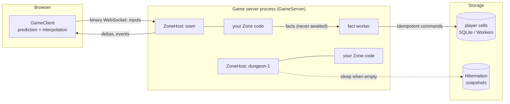

# distributed_game

A server-authoritative multiplayer game engine for the `distributed`
framework. You write the rules of a piece of your world (a **zone**) as a
plain Rust struct. The engine runs it at a fixed tick rate, takes player
input, sends each player only the changes they can see, saves important
outcomes without ever pausing the game, and spreads zones across as many
server processes as you need. A TypeScript client SDK
(`@hops-ops/distributed/game`) connects browsers to it, with prediction and
smoothing built in.

It replaces the role a room server like Colyseus plays, but in Rust and on
the same event-sourced storage the rest of `distributed` uses.

**It is:** the authoritative simulation loop, networking, replication,
persistence of outcomes, and world layout across servers.

**It is not:** a renderer, a physics engine or a content pipeline. Bring
your own physics and step it inside `on_tick`. The demos use Babylon.js in
the browser, but the client SDK has no rendering dependency.

## Contents

- [The big picture](#the-big-picture)
- [Try it](#try-it)
- [Build a zone](#build-a-zone)
- [Guides](#guides): game loop · input · what clients see · the client SDK ·
  saving progress · scaling out · live updates · lag compensation ·
  testing and operations · security
- [Design decisions](#design-decisions)
- [Status and limits](#status-and-limits)
- [Reference](#reference)

## The big picture



The words used throughout:

| Term | Meaning |
|---|---|
| **Zone** | One piece of the world with its own rules and state: a room, an arena, a dungeon floor, a 32 m map cell. Your code implements the `Zone` trait. Zones are the unit of simulation, ownership and scaling. |
| **ZoneHost** | Runs one zone: the fixed-timestep loop, connected clients, input queues, timers, replication. Has no networking of its own, so it is easy to test with a `ManualClock`. |
| **GameServer** | (`net` feature) A WebSocket server hosting many zones, creating them on demand, routing players, and serving `/metrics` and admin routes. |
| **Tick** | One fixed simulation step (30 Hz by default). Separate from the **patch** rate (20 Hz by default), how often clients get updates. |
| **Player / Observer** | A *player* controls something and sends inputs. An *observer* only watches: a spectator, a leaderboard page, or a client looking into the zone next door. |
| **Entity** | Something clients can see. The zone describes its entities each patch; the engine works out what changed for each client. |
| **Schema** | The kinds of entity and their fields (with quantization). Sent to clients on connect, so clients need no generated code. |
| **Fact** | An outcome worth keeping ("Alice killed the elite, +60 XP"). The zone emits it and moves on; a background worker commits it to storage and reports back later. |
| **Cell** | Durable, event-sourced state in `distributed`, for example one player's profile. Facts usually end up as commands on a cell. |
| **Ticket** | A signed, single-use admission token naming the player (principal), the zone and a role. Identity always comes from the ticket, never from game input. |

### The life of a tick

1. Inputs arrive over the socket. Each is numbered; the host drops
   duplicates and stale ones, decodes them with `Zone::decode_input`, and
   checks them with `Zone::sanitize_input`.
2. The host calls `Zone::on_tick`. Your code reads inputs with
   `ctx.take_inputs`, moves things, resolves combat, and may emit facts,
   events, timers or a handoff.
3. On patch ticks the host calls `Zone::replicate`. For each client it
   compares what you described with what that client last received, keeps
   only what the client can see (interest), fits it into the client's byte
   budget (most important first), and sends one binary **Delta** with the
   number of the last input it processed.
4. The browser applies the Delta. Other entities are drawn slightly in the
   past (interpolated) so they move smoothly. The player's own character is
   predicted from their inputs and quietly corrected when the server
   disagrees.
5. Meanwhile, emitted facts are committed by the fact worker. When one
   settles, `Zone::on_fact_settled` runs on a later tick (to show
   "saved ✓", for example). The tick never waits for storage.

## Try it

Seven runnable demos live in [`examples/game`](../examples/game/README.md),
each built to show one part of the engine:

| Demo | Run | Shows |
|---|---|---|
| Arena | `examples/game/run.sh arena` | ticks, deltas, prediction on/off, interest radius vs. global entities, simulated latency |
| Mob Pit | `run.sh mobpit` | combat whose rewards are saved without stalling; "slow storage"; `kill -9` crash recovery |
| Leaderboard | `run.sh leaderboard` | a live ranking fed from saved kills, rebuilt from history |
| Shooting Gallery | `run.sh gallery` | lag compensation on/off under latency |
| The Freeze | `run.sh freeze` | pausing every zone on two servers, updating content, resuming; safe-room reloads |
| Endless Grid | `run.sh grid` | a generated world split into zones across two servers, seamless border crossings, zones sleeping and waking |
| Boss Ripple | `run.sh ripple` | nested zones (realm › city › borough › neighbourhood) with events travelling up |

Then open `http://localhost:5173/<demo>/`. Each page explains what to try.

## Build a zone

A zone is a struct plus a few trait methods. This one is a dot that
players push left and right:

```rust
use std::sync::Arc;
use std::time::Duration;
use distributed_game::*;

struct Room { x: f32 }

impl Zone for Room {
    type Config = ();
    type Input = i8;          // -1, 0, 1
    type Timer = ();

    // What clients can see: one kind, "dot", with a quantized x.
    fn schema() -> EntitySchema {
        EntitySchema::new().kind(
            KindDef::new(1, "dot")
                .field("x", FieldType::QuantF32 { min: -50.0, max: 50.0, bits: 12 }),
        )
    }

    fn on_create(_ctx: &mut Ctx<'_, Self>, _: ()) -> Self { Room { x: 0.0 } }

    // Bytes from the client → your input type. Never trust them:
    fn decode_input(&self, _p: PlayerId, bytes: &[u8]) -> Option<i8> {
        bytes.first().map(|b| *b as i8)
    }
    fn sanitize_input(&self, _p: PlayerId, dx: i8) -> Option<i8> {
        (-1..=1).contains(&dx).then_some(dx)
    }

    // The game rules, once per tick.
    fn on_tick(&mut self, ctx: &mut Ctx<'_, Self>) {
        let players: Vec<_> = ctx.players().map(|p| p.id).collect();
        for p in players {
            for input in ctx.take_inputs(p, ConsumePolicy::Drain) {
                self.x += f32::from(input.input) * 5.0 * ctx.dt_secs();
            }
        }
    }

    // Describe the world; the engine diffs it per client.
    fn replicate(&self, out: &mut WorldView) {
        out.push(EntityState::new(1, 1, self.x, 0.0, vec![FieldValue::F(self.x)]));
    }
}

// Drive it directly (tests, tools) with a manual clock:
let clock = ManualClock::new();
let mut host = ZoneHost::<Room>::new("room-1", HostConfig::default(), Arc::new(clock.clone()), ());
let claims = TicketClaims::new("alice", "room-1", u64::MAX, "n", Role::Player);
let joined = host.join(&claims, 0, "").unwrap();
host.push_input(joined.client, 1, 0, &[1]);
clock.advance(Duration::from_millis(100));
host.advance();
for out in host.drain_outbound() { /* Outbound::Frame bytes go to the client */ }
```

Serve it over WebSockets (`net` feature). The closure decides which zone
ids this server hosts and with what config:

```rust,ignore
let server = GameServer::<Room>::new(ServerConfig::new(TicketKey::new(secret)), |zone_id| {
    zone_id.starts_with("room-").then_some(())
});
server.serve(tokio::net::TcpListener::bind("0.0.0.0:2567").await?, shutdown_signal).await?;
```

Connect a browser:

```ts
import { GameClient, InputPacer } from '@hops-ops/distributed/game';

const game = new GameClient<number>({
  url: (zone) => `wss://game.example/zones/${zone}`,
  ticket: ({ zoneId, role }) => api.mintZoneTicket(zoneId, role), // your backend signs these
  prediction: {
    encodeInput: (dx) => new Uint8Array([dx & 0xff]),
    predict: (s, dx, dtMs) => ({ x: s.x + (dx * 5 * dtMs) / 1000 }), // same rule as on_tick
    controlledEntity: () => 1
  }
});
await game.connect('room-1');
const pacer = new InputPacer({ tickRate: () => game.authority?.connection.welcome?.tickRate });
requestAnimationFrame(function frame(now) {
  pacer.update(now, (dtMs) => game.sendInput(readKeys(), dtMs)); // one input per server tick
  draw(game.render());                                  // entities ready to draw
  requestAnimationFrame(frame);
});
```

The rest of `Zone` is optional hooks: `on_auth`, `on_join`, `on_leave`,
`on_rejoin`, `on_observe`, `on_timer`, `on_fact_settled`,
`on_tier_changed`, `on_dispose`, `hibernate` / `on_restore`,
`on_handoff_join`, `on_child_event`, `is_gate`, `freeze_ready`,
`on_content_version_changed`, `record_rewind`, `state_hash`. Each is
explained in the guide that uses it.

## Guides

### The game loop

`ZoneHost::advance()` runs as many fixed steps as real time requires,
capped at `HostConfig::max_catch_up` (5) so a stalled process skips ahead
instead of fast-forwarding. `ctx.dt_secs()` is always the fixed step.

A zone is in one of three **tiers**:

- **Hot**: someone is connected; full `tick_rate` (30 Hz).
- **Idle**: empty; ticks at `idle_tick_rate` (1 Hz) so timers and
  respawns keep going. Return `true` from `Zone::wants_background` to stay
  Idle forever (a city clock, say) or from `has_pending_work` to stay Hot.
- **Dormant**: idle for `dormant_after` (30 s); no ticks. With
  hibernation on, a Dormant zone is saved and unloaded (see
  [Scaling out](#scaling-out-many-zones-many-servers)).

`on_tier_changed` tells you about transitions. Timers
(`ctx.set_timeout(after, value)`, `ctx.set_interval(every, value)`,
`ctx.cancel_timer(id)`) fire `on_timer` on the tick they are due;
`ctx.rng()` is a seeded RNG derived from the world seed and zone id, so a
recorded session replays identically.

### Input

Clients number every input. The host keeps a bounded queue per player,
rejects duplicates and inputs older than the last processed one, and
reports the last processed number back in every Delta. The client uses
that to drop inputs the server has already applied when it reconciles.

- `decode_input` turns bytes into your type; `sanitize_input` rejects or
  clamps anything a cheater could send (speed hacks, out-of-range values).
- `ctx.take_inputs(player, ConsumePolicy::…)` reads them in `on_tick`.
  `InputCredits` allows one input per tick per player (with a small bank
  for network jitter), so flooding inputs cannot make anyone move faster.
- Every new connection (a fresh ticket, a reconnect token, or a reconnect
  after a content reload) starts its numbering again from 1, and so does
  the host.
- A player who reconnects with a fresh ticket while still in the zone
  gets `on_rejoin`, by default `on_leave(Rejoined)` then `on_join`, so the
  zone re-sends whatever a new client needs.
- While the world is frozen for an update, inputs are dropped and counted.

### What each client sees

Each patch, `replicate` describes every entity once, as `EntityState`s
with a position and the schema's fields. For each client the engine then
sends only the difference from what that client already has:

- **Schema and quantization.** Fields are typed (`QuantF32`, integers,
  booleans, strings, …). Floats are quantized to the precision you choose,
  and a change too small to show up after quantization costs nothing.
- **Interest.** Each viewer has a `View` (centre and radius, set with
  `ctx.set_view`). Entities outside it are not sent and are removed from
  the client when they leave it. A spatial grid makes this cheap. Mark
  entities that everyone must always see (players in a small room, a boss,
  pillars) with `.global()`.
- **Bandwidth budget.** Each client has `byte_budget` bytes per Delta
  (4 KiB). Creates and updates compete by priority (kind × entity ×
  field × nearness). Anything deferred builds up priority, so it is always
  sent eventually.
- **Events** (`ctx.send_event(viewer, type_id, bytes)`,
  `ctx.broadcast_event(type_id, bytes)`) carry one-off messages such as "kill", "saved" or "weather changed" next to the
  Deltas.

Wire details are in [`PROTOCOL.md`](PROTOCOL.md).

### The client SDK

`GameClient` (`@hops-ops/distributed/game`) handles the connection,
reconnection and clock sync, and gives you `render()`: a list of entities
ready to draw.

- **Interpolation.** Other entities are drawn a little in the past,
  between two received states, so movement is smooth whatever the network
  does. The delay adapts to measured latency and jitter (`AdaptiveDelay`).
- **Prediction.** The player's own entity moves the moment they press a
  key, using your `predict` function (the same rule as the server). Each
  Delta, the client replays not-yet-acknowledged inputs on top of the
  server's state; any difference is resolved per field (`ease`, `snap` or
  `replace`). `setPredictionEnabled(false)` turns it off, to feel the raw
  latency.
- **Neighbouring zones.** `observe(zone)` opens a watch-only connection,
  so a player sees across a border before crossing it.
- **Crossing zones.** When the server hands the player to another zone
  (possibly on another server), the client follows automatically. The
  predicted character is held in place until the new zone takes over, and
  if the new zone refuses, the client goes back.
- **Content reloads.** `reloadContent` is called when the server requires
  a newer content version, and the client rejoins afterwards with the same
  player.

### Saving progress without pausing the game

The rule: **the tick never waits for storage.** A slow disk or a busy
database must not freeze the world. Zones emit **facts** and continue:

```rust,ignore
let key = ctx.fact_key("kill", &[&mob_id, &mob_generation]);
ctx.emit_fact_for(killer, Fact::new(key, "crawler.record_kill", json!({"mob": "elite"})))?;
```

- The host attaches the killer's **verified identity** from their ticket.
  The zone cannot claim to be someone else, and the payload names no
  reward amount; the storage side decides the XP from the facts it
  trusts.
- A background worker commits facts with retries.
  `cell::CellFactSink` turns each one into a command on that player's
  cell, with a command id derived from the fact key. A retry or a
  duplicate is therefore a harmless replay, never a double reward.
- `on_fact_settled` reports the outcome on a later tick.
- Keys must be unique across restarts; `ctx.fact_key` includes the
  activation's boot epoch for you (see [Durable facts](#durable-facts)).
- If the process crashes, each in-flight fact is either fully saved or
  not saved at all. Mob Pit shows this with `kill -9`.

### Scaling out: many zones, many servers

- **Placement.** A `ZoneDirectory` (`HashRing`) maps each zone id to a
  host. A client that connects to the wrong host is told where to go
  (`Redirect`) and follows automatically.
- **One owner at a time.** Each activation of a zone holds a fenced claim
  (`ZoneOwnership`, with leases in production). Two servers never run the
  same zone, and a server that loses its claim stops without saving.
- **On demand and asleep.** Zones start on first use. With
  `hibernate_after`, an empty zone is saved (`Zone::hibernate`) and
  unloaded, and restored (`on_restore`) the next time someone arrives.
- **Handoff.** `ctx.handoff(player, "next-zone", carried_bytes)` moves a
  player to another zone, on any server, with a signed transfer ticket.
  The target receives `on_handoff_join` with the carried state. When the
  player's durable records must move too, emit a fact and let a
  `distributed::saga` do it off the tick.
- **Hierarchy.** Zone ids like `realm.city.borough` form a tree
  (`DottedTopology`). `ctx.emit_upward(…)` sends an event to the parent
  zones, wherever they run, and each level can tick at its own rate
  (`GameServer::with_host_config`).

### Live content updates

`WorldCoordinator::rollout` updates content across every server:

1. **Freeze**: every zone pauses, shows the update notice, and drops
   inputs. A zone can delay with `freeze_ready` (for example, mid-ritual).
2. **Apply**: your function switches the content version (it may be
   async, a download for example).
3. **Resume**: everyone continues on the new version. Facts are stamped
   with the version they happened under.

If any zone does not acknowledge in time, the rollout is **aborted** and
everyone resumes on the old version. In `Hard` mode every client reloads
at once. In `Rolling` mode with `StalePolicy::SafeRoom`, clients that
cannot patch live keep playing until they walk into a gate zone
(`is_gate`), where they reload.

### Lag compensation

For hit-scan weapons, the server judges a shot against where targets were
**on the shooter's screen** when they fired, not where they are when the
shot arrives. `record_rewind` stores hit volumes each tick, and
`ctx.rewind().hit_test_shot(timing, ray, filter)` tests against that
moment, capped at `max_rewind` (500 ms by default) so lag cannot buy
unlimited rewind.

### Testing and operations

- **Deterministic tests**: drive `ZoneHost` with `ManualClock`; the RNG
  is seeded.
- **Record and replay**: `Recorder` captures a session; `replay` re-runs
  it and pinpoints the first tick that differs.
- **Metrics**: `GET /metrics` (Prometheus): tick time, players, entities,
  inputs by outcome, bytes per Delta, facts pending and settled.
- **Load bots**: `game-bots` connects N WebSocket clients and reports
  round-trip time and bandwidth.
- **Network simulation**: `NetSim` adds latency, jitter and loss in
  development, and can be changed at runtime.

### Security

- Players are admitted only with a signed, single-use, expiring ticket.
  Your web backend mints it; plug in your own verifier with
  `with_ticket_verifier`.
- The ticket's principal is the only identity the zone sees, and the only
  one attached to facts. Inputs are game data, never identity, owner or
  reward amounts.
- Admin routes (transfers, tier events, rollout) need a separate shared
  secret.

## Design decisions

- **Server-authoritative, not lockstep or peer-to-peer.** The server owns
  the truth and clients predict. That tolerates cheaters and mixed
  latencies, and needs only one simulation per zone.
- **Zones, not one global world loop.** A zone is the unit that ticks,
  sleeps, moves between servers and is owned by exactly one process.
  Actors live inside their zone. Only things that outlive a zone (a
  player's profile, a match) get their own durable cell.
- **Facts, not per-tick persistence.** Movement and combat ticks are never
  stored, only meaningful outcomes. The tick enqueues and moves on, so
  storage speed never shows up as lag.
- **Idempotency through keys, not a zone-side outbox.** A fact key plus
  the cell's command ledger make retries safe. An outbox on the zone
  would add a second write per outcome for little gain, since the zone
  state lost in a crash is lost either way.
- **Static world from a seed.** Terrain and props are a pure function of
  seed and content version, generated identically on server and client.
  Only things that change are replicated.
- **Binary protocol with the schema sent on connect.** Small,
  diff-friendly frames, and any client can decode them without generated
  code.
- **Reliable, ordered WebSockets.** Deltas are computed against what each
  client last received, which only works because nothing is lost or
  reordered. Loss shows up as delay, which the adaptive interpolation
  absorbs.

## Status and limits

- Pre-release, on the unreleased v5 line.
- Covered by unit, integration and golden-wire tests, plus the demos'
  smoke tests (bots and headless browsers).
- **Not yet verified here:** `FencedLeaseOwnership` on Postgres (Docker
  was unavailable) and the Redis leaderboard against a real Redis (only a
  fake).
- No production deployment or load testing beyond local bots.
- WebSocket only (no UDP or WebTransport). No built-in physics. Input
  replay on the client assumes your `predict` matches `on_tick` exactly.

---

# Reference

## Features

| Feature | Adds | Deps |
|---|---|---|
| *(default)* | Zone/host runtime, facts queue, protocol, schema, replication | `serde_json` |
| `runtime` | `spawn_fact_worker` on Tokio | `tokio` (rt, time, sync) |
| `cell` | `cell::CellFactSink` → `AggregateCell::dispatch_idempotent`, `stamp_event_record` | `distributed`, `sha2` |
| `metrics` | `metrics::GameMetrics` per-zone Prometheus text | – |
| `net` | `net::GameServer` (axum WebSocket), HMAC tickets, `GET /metrics` (implies `metrics`), handoff, admin peer routes, `WorldCoordinator` | `axum`, `hmac`, `sha2`, `base64`, `tokio` |
| `bots` | `bots` load-test client library + `game-bots` binary | `net` + `tokio-tungstenite` |
| `lease` | `world::FencedLeaseOwnership` over `distributed::lease` | `distributed` |
| `sqlite` | `world::SqliteZoneStateStore` (hibernation snapshots) | `rusqlite` (bundled) |

## Durable facts

Zones never await storage. Emit a fact during a tick:

```rust,ignore
let key = ctx.fact_key("kill", &[&enemy_id, &enemy_generation]); // "kill:{zone}:{boot_epoch}:…"
ctx.emit_fact_for(player, Fact::new(key, "hero.credit_xp", json!({"amount": 25})))?;
```

> **Warning — restart-safe keys.** Ticks, entity ids and generations all
> restart from zero when a process restarts (or a zone is re-activated from
> a snapshot). A key derived only from them — `format!("kill:{zone}:{tick}")`
> — **collides with an earlier run's key**, and an idempotent sink then
> treats the new outcome as a replay of the old one: the XP is silently
> never credited. Always include `ctx.boot_epoch()` (unique per activation,
> increasing across restarts; the `net` server uses the activation's fencing
> token, a bare `ZoneHost` Unix microseconds, or `HostConfig::boot_epoch`)
> — `ctx.fact_key(prefix, parts)` / `fact_key(prefix, zone, epoch, parts)`
> do it for you.

The host binds the principal from the player's **verified ticket** and
stamps zone/tick/content version. A `FactSink` commits facts on a worker
with bounded retries/backoff; `Zone::on_fact_settled` receives the outcome
on a later tick. `cell::CellFactSink` dispatches into an `AggregateCell`
with a deterministic command id per fact key, so retries replay instead of
double-crediting. A custom sink needs only crate-root imports:
`impl FactSink for MySink { fn commit<'a>(&'a self, fact: &'a Fact) -> BoxFuture<'a, Result<FactReceipt, FactError>> { Box::pin(async move { … }) } }`
(`BoxFuture` is also re-exported from `world` and `net` for
`ZoneOwnership` / `BarrierParticipant` impls).

**Throughput.** One worker per zone commits facts in emission order, one at
a time (a slow commit delays every later fact). Set
`ServerConfig::max_concurrent_commits` (or
`FactFeed::with_max_concurrent_commits`) above 1 to overlap commits in
**per-principal lanes**: a principal's facts (and, separately, zone facts
without a principal) stay sequential in emission order; different
principals commit concurrently; settlements arrive in completion order.

## Netcode and operations

- **Admission tickets** (`net`): by default join tickets are HS256 JWTs
  signed with `ServerConfig::ticket_key` (PROTOCOL.md §8). To admit tickets
  your web backend already mints, plug in a verifier —
  `ServerConfig::new(key).with_ticket_verifier(|token: &str, zone: &str, now: u64| { … })`
  (or implement `net::TicketVerifier`) — that checks your issuer, audience
  and lifetime (`net::decode_hs256` verifies an HS256 signature and
  returns the claims) and returns `TicketClaims` with `zone` = the route
  zone and `nonce` = your replay key (e.g. `jti`). The server still
  enforces route zone, expiry and single use; `TicketClaims::name` becomes
  `PlayerInfo::name` / `ObserverInfo::name` and travels with handoffs.
  Transfer tickets always use `ticket_key`.
- **Input pacing**: `InputCredits::new(max)` gives each player one input
  credit per tick (banking up to `max` for jitter bursts);
  `credits.take(ctx, player)` consumes queued inputs while credits last, so
  a client can never simulate faster than real time by flooding inputs.
  Pair it with the JS SDK's `InputPacer` (one input per server tick from a
  render loop).
- **Observers**: `Ctx::observer(id)` / `observers()` / `observers_of(principal)`
  expose each observer's verified principal and name (also during
  `on_unobserve`); `ctx.send_event(observer_id, …)` addresses one observer.

- **Lag compensation** (`rewind`): implement `Zone::record_rewind` to push
  hit volumes (sphere / vertical capsule + numeric fields) each tick; the
  host keeps a ring buffer sized by `HostConfig::rewind.max_rewind`
  (default 500 ms). In a hook,
  `ctx.rewind().hit_test_shot(ShotTiming { client_tick, interp_delay }, &HitQuery::ray(o, d, range), |id| id != me)`
  evaluates at the shooter's view time, clamped to `max_rewind` and the
  stored history. The interpolation delay travels in the game's input
  payload (no wire change).
- **Record/replay** (`replay`): drive a host through `Recorder` (same
  methods as `ZoneHost`), save the compact `Recording` (`DGR2`), and
  `replay::<Z>(&recording, config)` re-runs it on a `ManualClock`,
  checking a per-tick state hash (`Zone::state_hash`, or the replicated
  `WorldView`). A mismatch returns a `Divergence` naming the tick and the
  stimuli applied since the last matching tick. Fact settlements are
  replayed on the tick they were delivered. World entry points (`join_transfer`,
  `reconnect_with_version`, `set_content_version`, `request_freeze` /
  `cancel_freeze`, `reload_stale_players`, `deliver_child_event`,
  `restore`) are recorded too; zone-issued handoffs replay against a stub
  issuer that always signs.
- **Metrics** (`metrics`, served by `GameServer` at `GET /metrics`):
  tick duration histogram, ticks/dropped ticks, tier, players, observers,
  entities, inputs by outcome (incl. `rate_limited` and `frozen` barrier drops),
  Delta bytes per frame, facts pending/settled.
  Only the first `ServerConfig::metrics_zone_labels` (default 64) live
  zones get a `zone` label; the rest aggregate into `zone="_other"`.
  `AdvanceReport` carries the raw numbers for custom drivers.
- **Bots** (`bots`): `run_bots(BotConfig, |i| behaviour)` connects N
  WebSocket clients with signed tickets, sends inputs (random walk,
  circle, or your own `Behaviour`), measures RTT and Delta bytes/s:
  `cargo run -p distributed_game --features bots --bin game-bots -- --url ws://127.0.0.1:2567 --zone room-1 --bots 50`.
- **Network simulation** (`NetSim`, dev only): one-way latency + uniform
  jitter + loss, per direction. WebSockets are reliable and ordered, so
  loss is simulated as a TCP retransmission delay (`retransmit`, default
  200 ms, up to 3×) with head-of-line blocking, never as a dropped or
  reordered message. `config.net_sim = NetSim::from_env()` reads
  `DG_NET_LATENCY_MS`, `DG_NET_JITTER_MS`, `DG_NET_LOSS`,
  `DG_NET_RETRANSMIT_MS`. `GameServer::set_net_sim(Some(sim) | None)`
  changes it at runtime for every connection (order is preserved).

## World structure

`world` (no feature needed for the traits and in-memory impls):

| Piece | Purpose |
|---|---|
| `ZoneDirectory` (`StaticDirectory`, `HashRing`) | zone → owning `HostAddr`. `HashRing` uses virtual nodes; adding/removing one of N hosts moves ~1/N of the zones. A Hello for a zone owned elsewhere gets `Redirect(zone, url)`; `url` is the owner's `HostAddr::ws_url` (advertise a proxied public URL with `HostAddr::with_ws_url`) or `ServerConfig::with_redirect_url(\|host, zone\| …)`. |
| `ZoneOwnership` (`LocalOwnership`, `FencedLeaseOwnership<S: LeaseStore>`) | every activation acquires a fenced claim (`host#activation`) and renews it; a failed renewal disposes the zone **without** saving. Two hosts never run the same zone. |
| `ZoneStateStore` (`MemoryZoneStateStore`, `SqliteZoneStateStore`) | hibernation snapshots, written under the claim's fencing token (stale writers get `StateError::Stale`, counted in `distributed_game_hibernation_saves_total{outcome="stale"}` and logged to stderr, never silently dropped). `LocalOwnership` seeds its tokens from the Unix time (µs) at creation, so a restarted host still outranks the snapshots its previous run saved. |
| `ZoneTopology` (`DottedTopology` default: `eldoria.port.docks` → `eldoria.port` → `eldoria`) | parent links for tier-up events. |

**Per-zone host settings.** `GameServer::with_host_config(|zone_id, host|
…)` adjusts the `HostConfig` of each activation (e.g. a province ticking at
2 Hz while its neighborhoods run at 30 Hz); the world content version is
applied afterwards.

**Activate on demand / hibernate.** `GameServer` creates a zone on first
join (or tier-up event). With `ServerConfig::hibernate_after = Some(d)` a
zone that stays Dormant for `d` (no clients, no in-flight facts, not
frozen) is hibernated: unregistered atomically (later joins start a new
activation, which waits for this one's claim), `Zone::hibernate()` is
stored, `on_dispose` runs, the claim is released. The next activation
calls `Zone::on_restore`.

*Facts on dispose:* a zone only becomes Dormant with zero unsettled
facts, so hibernation never strands a settlement. Facts emitted during
disposal (e.g. in `on_dispose`) are still committed: the fact worker
drains its queue after the zone drops it, and the zone task waits up to
`settle_timeout` for it. We chose "settle, then dispose" over a durable
fact outbox because the zone-side queue is already bounded and
idempotent; a crash-durable outbox belongs to the sink (e.g. the cell
adapter commits the fact atomically with its own outbox row).

**Handoff.** In a hook: `ctx.handoff(player, "realm.west", carried_bytes)?`.
The host signs a transfer ticket (principal, source, target, issuer host,
ownership generation, carried state, nonce, 30 s expiry), removes the
player (`LeaveReason::Handoff`) and sends `Handoff(target, ticket)`. The
target reserves the ticket with the issuing host (locally or via
`/admin/transfer`), admits it with `Zone::on_handoff_join(player, from,
carried)` and confirms; a refused transfer is released and the client may
present the same ticket back to the source (PROTOCOL.md §8.1). The
realtime path never waits on storage. When the player's **durable**
record must move too (home zone, inventory cell), emit a fact from the
handoff hook and let a `distributed::saga` drive it, off the tick:

```rust,ignore
// zone hook: non-blocking
ctx.emit_fact_for(player, Fact::new(format!("move:{nonce}"), "player.relocate",
    json!({"from": from, "to": to})))?;
// fact sink → SagaRunner::<_, Relocate>::start(nonce, data):
//   step "detach" → source cell (compensate: "reattach")
//   step "attach" → target cell (compensate: "detach_again")
// timeouts compensate; the game keeps playing on carried state meanwhile.
```

**Tier-up events.** `ctx.emit_upward("boss_defeated", payload,
ChildEvent::TO_ROOT)`; the server routes it to the parent (activating it,
on its owning host via `/admin/child-event`), whose host delivers
`Zone::on_child_event` on a later tick and forwards it further up while
`levels` remain.

**Content barrier.** `net::WorldCoordinator::rollout(version, notes, mode,
apply)` over `GameServer`s and `RemoteHost`s (admin HTTP, shared secret):
freeze all zones (`Freeze{version}`; `Zone::freeze_ready` may delay),
wait for every ack within the timeout, `apply(version)`, then commit
(`Resume{version, notes}`; facts/`ctx.stamp()` carry the new version).
`rollout_async(…, |version| async { … })` awaits an async `apply` while
every zone stays frozen (a visible "applying update" pause, no extra
barrier participant needed). A missing ack or failed `apply` aborts:
everyone resumes on the old version with `AbortNotes`
(`WorldCoordinator::with_abort_notes`; `{error}` expands to the apply
error). Inputs while frozen are dropped and counted
(`ZoneHost::inputs_dropped_frozen`). `HostConfig::stale_policy =
StalePolicy::SafeRoom { roam }` lets old clients keep playing after a
`BarrierMode::Rolling` commit until they reach a gate zone
(`Zone::is_gate`), where they get `Kick(RELOAD)` and reconnect with their
token after reloading — stale clients already inside a gate when the
rolling commit lands are reloaded there at once; `BarrierMode::Hard`
reloads every stale client at once.

Admin routes (enabled by `ServerConfig::admin_secret`, header
`x-game-admin-secret`): `POST /admin/transfer`, `/admin/child-event`,
`/admin/barrier/{prepare,commit,abort}` — see `net::world`.

## Protocol

See [`PROTOCOL.md`](PROTOCOL.md) — binary, little-endian, varints, one
message per WebSocket frame, schema shipped in Welcome so generic clients
need no codegen. Golden fixtures for other implementations are in
`tests/fixtures/`.

## Tests

```sh
cargo test -p distributed_game --all-features
UPDATE_GOLDEN=1 cargo test -p distributed_game --test golden   # accept wire changes
```
